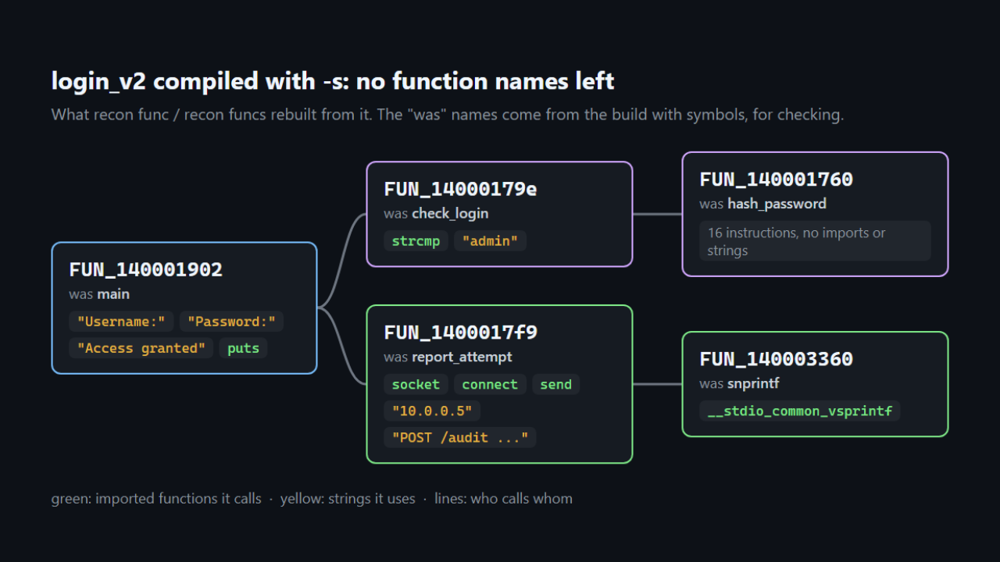
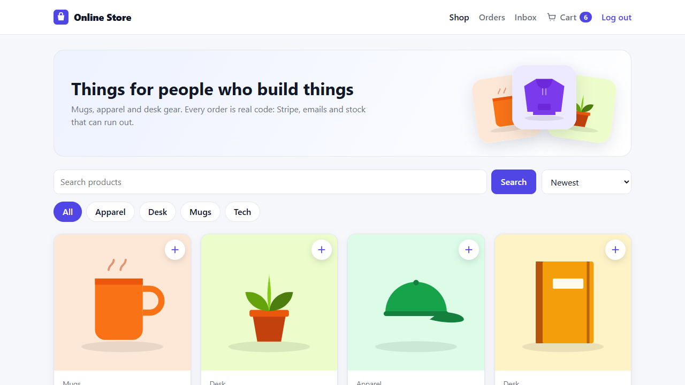
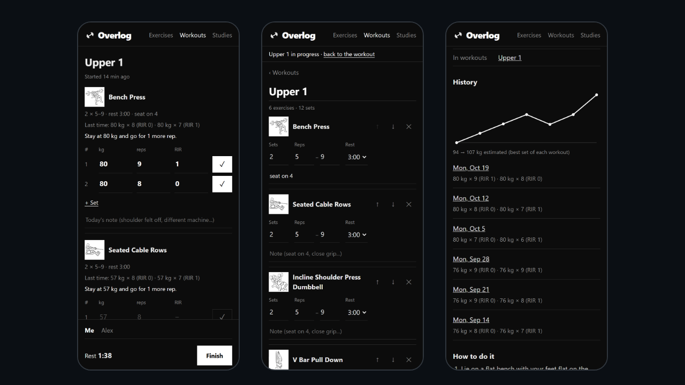
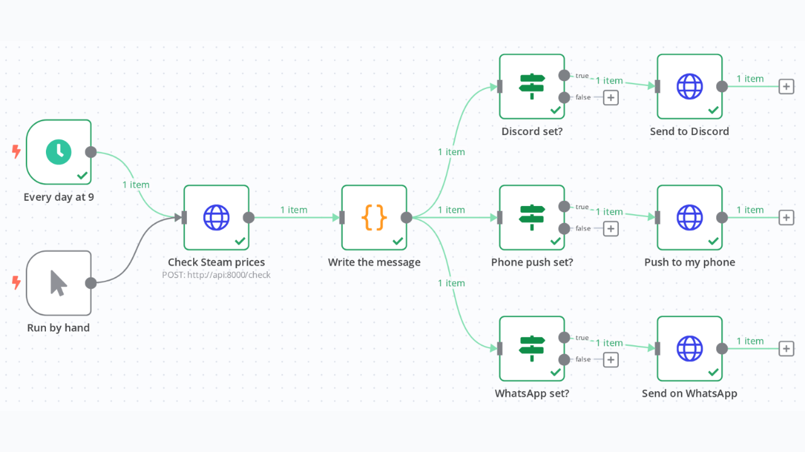
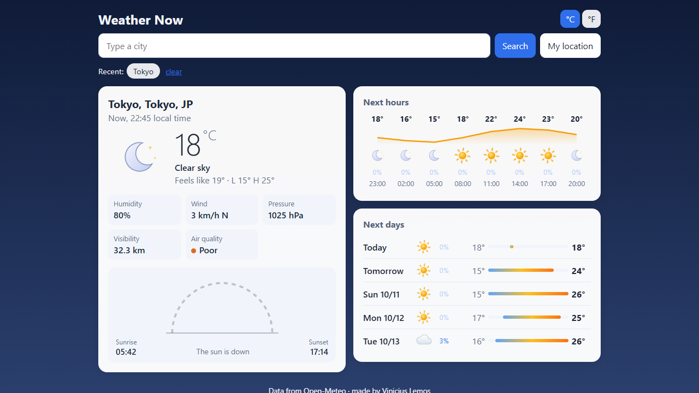

<h1 align="center">Hi, I'm Vinicius</h1>

  

  
  
  

---

### About me

- 4th semester of **Computer Engineering** at **Universidade Presbiteriana Mackenzie**, in São Paulo
- I mostly build **full-stack web apps** (React + Node/TypeScript) and **automations** in Python
- Building now: [RECON](https://github.com/ViniciuscLemos/recon), a reverse engineering tool that takes apart binaries with no source and no symbols, and [Overlog](https://github.com/ViniciuscLemos/overlog), the gym log I use myself
- I like projects that test the real thing: CI here spins up Postgres, n8n and even a Minecraft server
- Fluent in English

### Tech

  

---

### Featured projects

<table>
  <tr>
    <td width="50%" valign="top">
      
      <h4><a href="https://github.com/ViniciuscLemos/recon">recon</a></h4>
      Reverse engineering for unknown binaries. It reads PE and ELF files, disassembles the x86-64 code, rebuilds who calls whom and shows which functions changed between two versions, even with every name stripped out.  
        
    </td>
    <td width="50%" valign="top">
      
      <h4><a href="https://github.com/ViniciuscLemos/minecraft-ai-agent">minecraft-ai-agent</a></h4>
      A bot that plays Minecraft on your own server. You ask in plain text, it plans the steps and tested skills do the work: wood, tools, stone, glass and a whole farmhouse in about 30 minutes.  
        
    </td>
  </tr>
  <tr>
    <td width="50%" valign="top">
      
      <h4><a href="https://github.com/ViniciuscLemos/online-store">online-store</a> · <a href="https://online-store-6ogi.onrender.com">live</a></h4>
      Full e-commerce: Stripe payments, email confirmation, password reset, stock that can't oversell and an admin panel. The biggest thing I've built, with integration and e2e tests.  
         
    </td>
    <td width="50%" valign="top">
      
      <h4><a href="https://github.com/ViniciuscLemos/overlog">overlog</a> · <a href="https://viniciusclemos.github.io/overlog/">live</a></h4>
      The gym log I'm building for myself: weight, reps and RIR on every set, what to lift next time, unlimited workouts and it works offline. Still in progress.  
        
    </td>
  </tr>
  <tr>
    <td width="50%" valign="top">
      
      <h4><a href="https://github.com/ViniciuscLemos/price-watch-n8n">price-watch-n8n</a></h4>
      Steam sale alerts: every morning n8n checks the games on my list (in R$) and sends the deals to Discord, my phone or WhatsApp. CI runs the real workflow against a fake Steam.  
        
    </td>
    <td width="50%" valign="top">
      
      <h4><a href="https://github.com/ViniciuscLemos/weather-now">weather-now</a> · <a href="https://clima-agora-g5jz.onrender.com">live</a></h4>
      Weather for any city: now, the next hours, the week and air quality, with animated icons and a dark mode. The one I enjoyed building the most.  
        
    </td>
  </tr>
</table>

The live sites run on a free server that takes about 30 seconds to wake up on the first visit.

### More projects

| Project | What it is | Stack |
| --- | --- | --- |
| [expense-tracker](https://github.com/ViniciuscLemos/expense-tracker) | Monthly expenses with a chart by category and CSV export, works offline as a PWA. [Live](https://viniciusclemos.github.io/expense-tracker/) | React, Vite |
| [task-api-nodejs](https://github.com/ViniciuscLemos/task-api-nodejs) | Task API with JWT login and interactive Swagger docs | Node, Express, PostgreSQL, Docker |
| [banking-system-java](https://github.com/ViniciuscLemos/banking-system-java) | A bank in the terminal: accounts, transfers inside a DB transaction, CPF validation | Java, SQLite |
| [webscraper-python](https://github.com/ViniciuscLemos/webscraper-python) | Book scraper that saves to PostgreSQL or CSV/JSON and builds an HTML gallery | Python, BeautifulSoup |
| [csv-analyzer-python](https://github.com/ViniciuscLemos/csv-analyzer-python) | Reads a sales CSV and builds a report with SQL, in the terminal or as HTML | Python, SQLite |
| [battleship-java](https://github.com/ViniciuscLemos/battleship-java) | Battleship against the computer, a refactor of a college assignment | Java |
| [library-manager-c](https://github.com/ViniciuscLemos/library-manager-c) | Library system with reports and a binary file for the data | C |
| [todo-list](https://github.com/ViniciuscLemos/todo-list) | One of my first projects: a to-do list for the terminal | Python |

### GitHub

  
  

